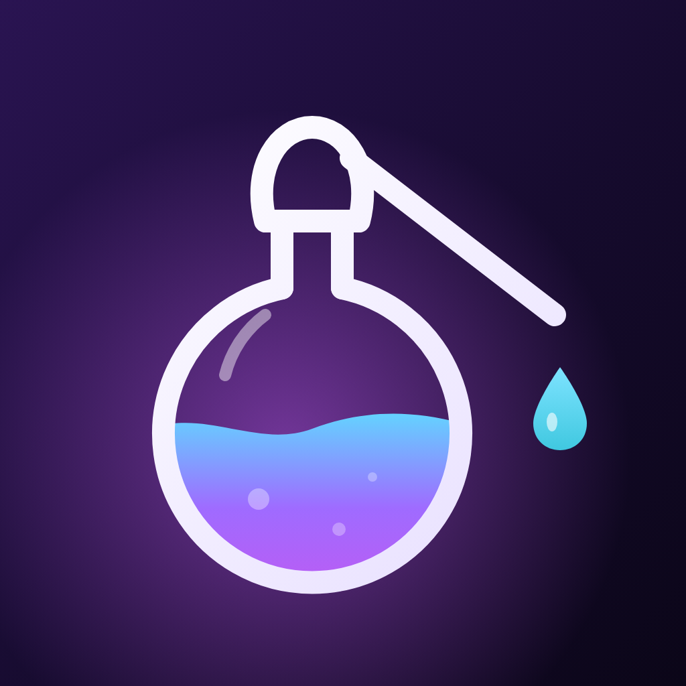
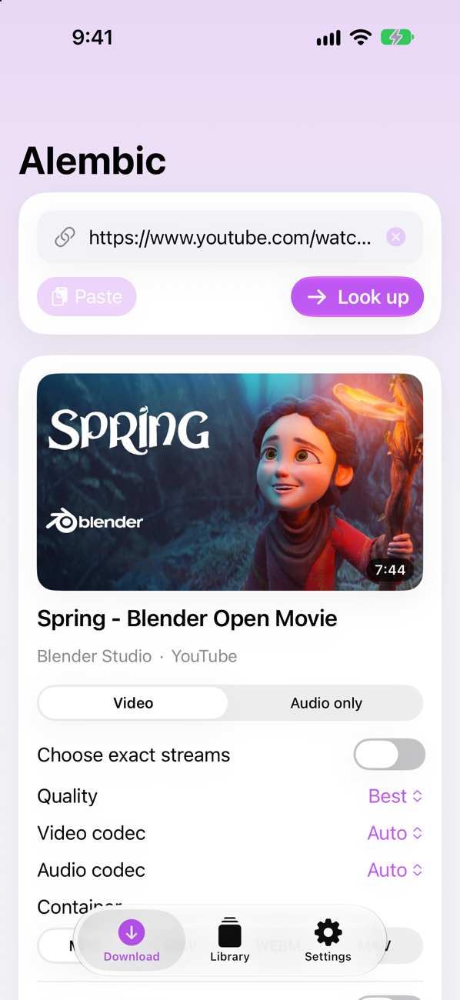
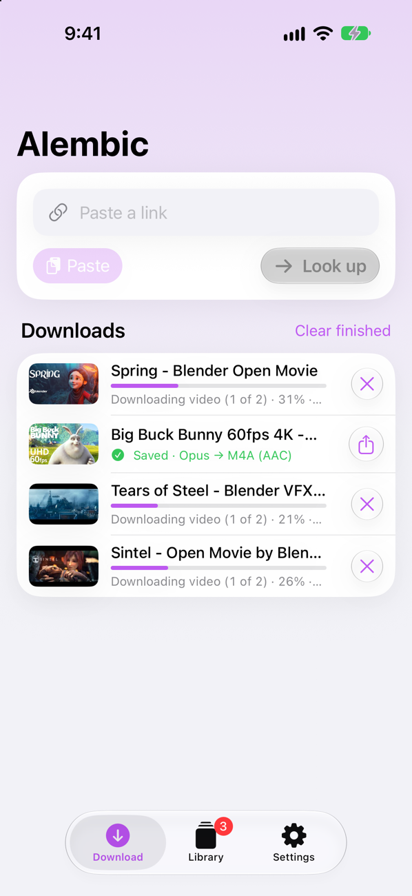
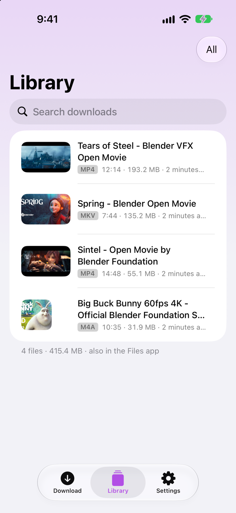
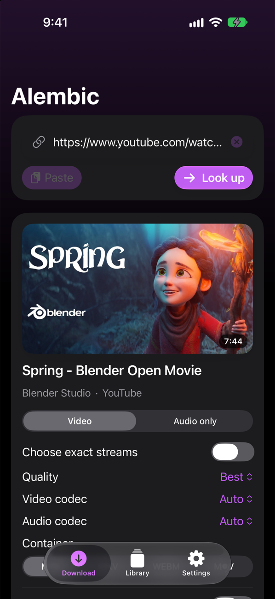
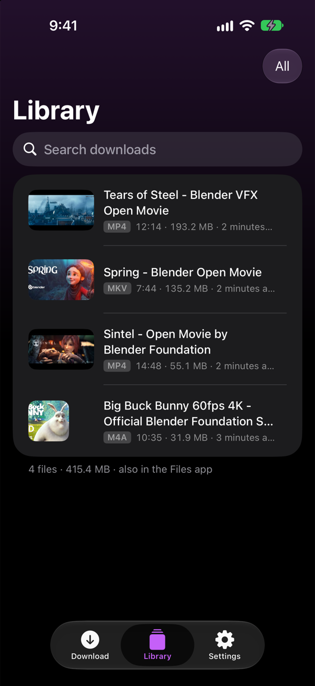
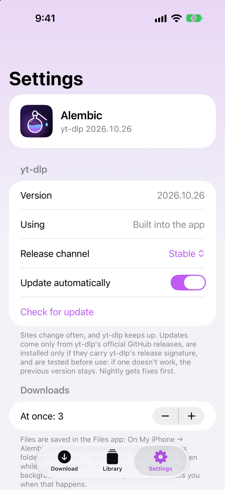

<div align="center">



# Alembic

**yt-dlp as a real iPhone app. Paste a link, pick exactly what you want, and it's saved on your phone.**

The real yt-dlp and FFmpeg run on the iPhone itself, with no server, no account, no ads and no tracking.


[**What it does**](#what-it-does) · [**Install it**](#install-it) · [**Under the hood**](#under-the-hood) · [**Security**](#security) · [**Building**](#building-it-yourself) · [**Licence**](#licence)

<br>


&nbsp;

&nbsp;


<sub>Real screenshots, with Blender Foundation open movies.</sub>

</div>

---

## What it does

**Paste a link, see what's there.** Copy a link from YouTube, X, Instagram, Reddit, TikTok or [any of the sites yt-dlp supports](https://github.com/yt-dlp/yt-dlp/blob/master/supportedsites.md), and Alembic shows the title, length and every stream on offer.

**Simple when you want it, exact when you need it.** Pick a quality and you're done. Or choose codecs (AV1, VP9, HEVC, H.264 for video; Opus or AAC for audio) and a container (MP4, MKV, WebM, MOV). Or turn on *Choose exact streams* and pick any video stream with any audio stream, like `yt-dlp -F`. Containers that can't hold your streams are caught before you download, not after.

**Audio only.** M4A (the default), MP3, Opus, FLAC or WAV. When the stream is already in the format you asked for, it's saved without re-encoding.

**Only the part you want.** Download a clip by time or by chapter. Only that part is fetched.

**Finished files are finished.** Cover art, title, artist and chapters are written into the file. Subtitles in any language, including YouTube's automatic ones. SponsorBlock cuts out sponsors, self-promos and subscribe reminders, with no re-encoding and the audio still in sync.

**Playlists and channels.** Tick the videos you want and choose one quality for all of them.

**A library on the phone.** Everything you've downloaded, with thumbnails, search and Apple's own player (AirPlay, Picture in Picture). Save videos to Photos, share them, or convert MKV/WebM to MP4 without losing quality. Every file is also in the Files app.

**Several at once.** Up to five downloads in parallel, with progress, speed and time left. Cancel any of them, or retry and it picks up where it stopped.

**Always current.** Sites change and yt-dlp keeps up. Alembic updates yt-dlp by itself, from yt-dlp's official releases only, and only after checking yt-dlp's signature (see [Security](#security)).

<div align="center">
<br>

&nbsp;

&nbsp;

</div>

> [!NOTE]
> Alembic never signs in to anything and never touches your accounts or cookies, so there's no account to get banned.

## Install it

It isn't on the App Store. You need an iPhone on iOS 26 or newer and [LiveContainer](https://github.com/LiveContainer/LiveContainer) (or SideStore/AltStore).

> [!TIP]
> **The easy way:** open **[ratterau.github.io/apps](https://ratterau.github.io/apps/)** on your iPhone and tap **LiveContainer**. Then install Alembic from LiveContainer's **Sources** tab. Updates show up there by themselves, and it doesn't use one of your 3 app slots.

Or, in LiveContainer: tap **+** → **Install from URL** and paste:

```
https://github.com/RatterAU/Alembic/releases/latest/download/Alembic.ipa
```

New to LiveContainer? The step-by-step setup (iloader, pairing file, SideStore, refreshing every 7 days) is in [Contrail's install guide](https://github.com/RatterAU/Contrail#option-a-livecontainer--sidestore). It works the same for Alembic.

**Where your files go:** the Files app, under *On My iPhone → Alembic*. Under LiveContainer, look in LiveContainer's folder under *Data → Application*.

**Keep Alembic open during big downloads.** iOS pauses apps in the background after a short while. Alembic notifies you if that happens, and Retry resumes where it stopped.

## Under the hood

iOS apps can't run other programs, so Alembic brings everything inside the app:

| Part | How |
|:--|:--|
| **yt-dlp** | The official release, running on CPython 3.13 ([BeeWare](https://github.com/beeware/Python-Apple-support)) embedded in the app. Unchanged, so it behaves exactly like yt-dlp on a computer |
| **FFmpeg 9** | Built for iOS with only what yt-dlp needs (7 MB). `ffmpeg` and `ffprobe` are built as libraries; when yt-dlp starts them, Python's `subprocess` runs them in-process on a thread, wired to real pipes, so yt-dlp needs no changes |
| **YouTube challenges** | yt-dlp normally needs Deno or Node for these. Alembic runs yt-dlp's own solver script in WebKit, in a locked-down hidden page with no network access |
| **The app** | SwiftUI, Liquid Glass, iOS 26+ |

```
App/          SwiftUI app, Python host (PythonHost.m), in-process FFmpeg runner (ToolRunner.c)
Engine/       The Python side: api.py (commands and jobs), procs.py (subprocess bridge),
              jsc.py (WebKit solver), sponsorblock.py (keyframe-aligned cuts),
              updater.py + pgp.py (signed updates), tests/
scripts/      build-ffmpeg.sh, fetch-engine.sh, install-python.sh (Xcode build phase)
project.yml   XcodeGen project
```

## Security

- **Every download is pinned.** FFmpeg, LAME, Opus, Mbed TLS, BeeWare's Python and yt-dlp are fetched by SHA-256 or signature. The Python packages are installed with `pip --require-hashes`.
- **yt-dlp updates are signature-checked.** An update is used only if yt-dlp's `SHA2-256SUMS` carries a valid signature from yt-dlp's release key (fingerprint `AC0CBBE6848D6A873464AF4E57CF65933B5A7581`, pinned in the app), and the file matches that checksum. The version is read from inside the verified file. Older versions are refused, and each update is tested before use: if it doesn't work, the previous version stays.
- **Nothing runs from outside the app.** yt-dlp plugins are off. Links are never passed as command-line options.
- **FFmpeg checks HTTPS certificates** against the bundled, hash-pinned `certifi` list.

## Building it yourself

You need a Mac with Xcode 27, [XcodeGen](https://github.com/yonaskolb/XcodeGen) and CMake (`brew install xcodegen cmake`).

```bash
git clone https://github.com/RatterAU/Alembic.git && cd Alembic
scripts/build-ffmpeg.sh       # FFmpeg + LAME + Opus + Mbed TLS for iPhone, simulator and Mac (about 15 min)
scripts/fetch-engine.sh       # Python support, yt-dlp and Python packages, all verified
xcodegen generate
xcodebuild -scheme Alembic -configuration Release -destination 'generic/platform=iOS' \
  CODE_SIGNING_ALLOWED=NO build
python3 Engine/tests/smoke.py /tmp/alembic-tests   # engine tests on the Mac (needs network)
```

## Privacy

No accounts, no ads, no analytics. Alembic only connects to the sites you download from, to GitHub to update yt-dlp, and, if you turn on sponsor cutting, to the SponsorBlock service.

## Licence

Alembic is free software under the [GNU GPL 3.0 or later](LICENSE).

It's built on [yt-dlp](https://github.com/yt-dlp/yt-dlp) (Unlicense), [FFmpeg](https://ffmpeg.org) (LGPL 3.0+), [LAME](https://lame.sourceforge.io) (LGPL), [Opus](https://opus-codec.org) (BSD), [Mbed TLS](https://github.com/Mbed-TLS/mbedtls) (Apache 2.0), [Python](https://www.python.org) (PSF) via [BeeWare](https://github.com/beeware/Python-Apple-support), [Mutagen](https://github.com/quodlibet/mutagen) (GPL 2.0+) and [certifi](https://github.com/certifi/python-certifi) (MPL 2.0). The screenshots show [Blender Foundation](https://studio.blender.org/films/) open movies (CC BY).
